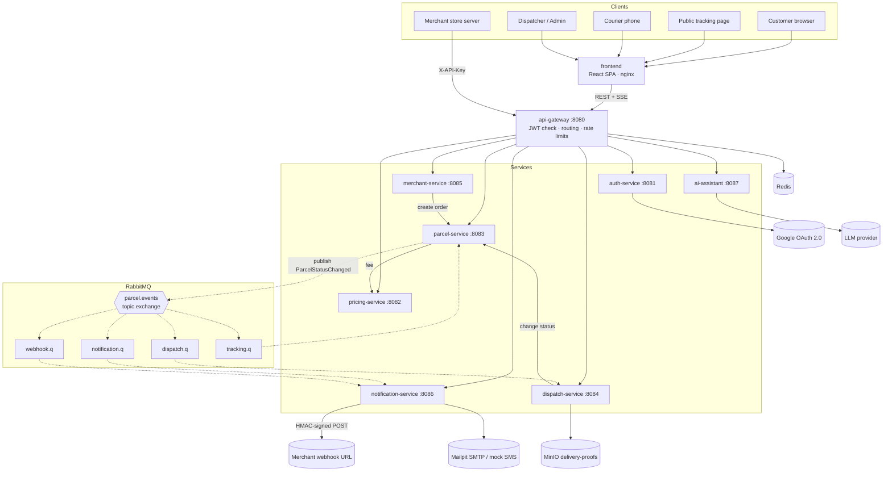

# SwiftDrop Architecture

Version 1 · 21 October 2026 · Owner: Role 1 (team lead)

This is the source of truth for how the system is built. Changes to anything here need a PR and, for big changes, an entry in [`decisions.md`](decisions.md).

---

## 1. Goals and constraints

From the assignment brief:

- Four user types: Customer, Merchant, Courier, Dispatcher/Admin, with role-based access.
- JWT authentication, plus OAuth 2.0 for "Login with Google" and merchant API access.
- Real-time parcel tracking (we use Server-Sent Events).
- At least one asynchronous integration pattern: status events through a message broker trigger notifications and merchant webhooks.
- Merchant webhooks retried on failure.
- Everything containerized and runnable with Docker Compose; Kubernetes is a bonus.
- Secure handling of personal data: validation, hashed passwords, nothing sensitive in errors or logs.

## 2. Architecture style

**Microservices behind an API gateway**, with these simplifications to keep it manageable for a student team:

| Simplification | Why |
|---|---|
| No service registry (Eureka) | Docker Compose and Kubernetes DNS resolve service names |
| No config server | Configuration from environment variables, which the brief requires anyway |
| One PostgreSQL instance, separate database per service | Keeps the database-per-service rule without seven DB containers |
| Shared `common` library | One implementation of error handling, security config, event DTOs and log masking (DRY) |
| Monorepo, Maven multi-module | One clone, one build, consistent versions |

### Why microservices for this project

- Each of the nine roles owns a service, so ownership, testing and the demo split cleanly.
- The integration patterns the brief marks (pub/sub, broker, webhooks) are real network boundaries, not simulated ones.
- The Kubernetes bonus is meaningful with several independently deployable services.

### Layers

| Layer | Components |
|---|---|
| Presentation | React SPA (all roles), mobile-first public tracking page |
| Edge | Ingress (Kubernetes) and `api-gateway` |
| Business logic | Seven Spring Boot services, each layered Controller → Service → Repository |
| Integration | RabbitMQ exchange and queues, notification consumer, webhook sender |
| Data | PostgreSQL, Redis, MinIO |

## 3. System diagram



A detailed visual version is in [`diagrams/architecture-overview.html`](diagrams/architecture-overview.html) (open in a browser) and in the design PDF.

## 4. Services

| Service | Port | Owner | Database | Responsibility |
|---|---|---|---|---|
| `api-gateway` | 8080 | Role 1 | — (Redis) | Single entry point, JWT verification, routing, CORS, rate limits, request IDs |
| `auth-service` | 8081 | Role 2 | `auth_db` | Signup/login, BCrypt, JWT issuing, refresh tokens, Google OAuth 2.0, roles, user admin |
| `pricing-service` | 8082 | Role 1 | `pricing_db` | Delivery zones, pricing rules, fee estimate |
| `parcel-service` | 8083 | Role 3 | `parcel_db` | Parcels, tracking numbers, status machine, history, receipt PDF, SSE stream, event publishing |
| `dispatch-service` | 8084 | Role 4 | `dispatch_db` | Couriers, assignments, workloads, courier day list, proof uploads, reports |
| `merchant-service` | 8085 | Role 5 | `merchant_db` | Merchant registration and approval, API keys, merchant order API, webhook settings |
| `notification-service` | 8086 | Role 6 | `notification_db` | Event consumers, email, mock SMS, webhook delivery with retry |
| `ai-assistant` | 8087 | Role 9 | — | Chat endpoint, MCP tools that call our APIs |
| `frontend` | 80 | Role 7 + Role 1 | — | React SPA for all roles |

### Main tables per database

| Database | Tables |
|---|---|
| `auth_db` | `users`, `roles`, `user_roles`, `refresh_tokens`, `oauth_accounts` |
| `pricing_db` | `zones`, `zone_districts`, `pricing_rules` |
| `parcel_db` | `parcels`, `parcel_status_history`, `outbox_events`, `processed_events` |
| `dispatch_db` | `couriers`, `assignments`, `delivery_proofs`, `daily_stats`, `processed_events` |
| `merchant_db` | `merchants`, `api_keys`, `webhook_endpoints` |
| `notification_db` | `notifications`, `webhook_deliveries`, `processed_events` |

The full ER diagram lives in the design PDF.

## 5. API surface

All public routes are prefixed `/api/v1` and go through the gateway. `/internal/**` routes are service-to-service only and are **not** exposed by the gateway.

| Service | Endpoints |
|---|---|
| auth | `POST /auth/register` · `POST /auth/login` · `POST /auth/refresh` · `POST /auth/logout` · `GET /oauth2/authorization/google` · `POST /auth/token` (exchange one-time code) · `GET, PATCH /admin/users` · internal `GET /.well-known/jwks.json` (no `/api/v1` prefix) |
| pricing | `GET /pricing/estimate?fromZone&toZone&weightKg&size` · CRUD `/admin/zones` · CRUD `/admin/pricing-rules` |
| parcel | `POST /parcels` · `GET /parcels` (mine) · `GET /parcels/{id}` · `GET /parcels/{id}/receipt` (PDF) · `GET /track/{trackingNo}` (public) · `GET /track/{trackingNo}/stream` (SSE, public) · internal `PATCH /internal/parcels/{id}/status` · internal `POST /internal/parcels` |
| dispatch | `GET /dispatch/unassigned` · `POST /dispatch/assignments` · `GET /dispatch/workload` · `GET /reports/daily?from&to` · `GET /courier/deliveries/today` · `POST /courier/deliveries/{id}/status` (multipart, optional photo) |
| merchant | `POST /merchants/register` · `GET /admin/merchants?status=PENDING` · `PATCH /admin/merchants/{id}/approve` · `POST /merchants/me/api-keys` · `DELETE /merchants/me/api-keys/{id}` · `PUT /merchants/me/webhook` · `POST /merchant-api/orders` (X-API-Key) · `GET /merchants/me/orders` |
| notification | `GET /admin/webhook-deliveries` · `POST /admin/webhook-deliveries/{id}/replay` |
| ai-assistant | `POST /assistant/chat` · MCP endpoint `/mcp` (tools: `track_parcel`, `estimate_fee`, `my_parcels`) |

Each service publishes its OpenAPI spec at `/v3/api-docs`; the gateway aggregates them in Swagger UI.

## 6. Communication

### Synchronous (request/reply over REST)

Used when the caller needs the answer before it can respond.

| Caller | Callee | Why |
|---|---|---|
| Gateway | All services | Routing of client requests |
| parcel | pricing | Calculate the fee when a parcel is created |
| merchant | parcel | Create a parcel for a merchant order |
| dispatch | parcel | Change parcel status (parcel owns the rules) |
| notification | auth, merchant | Look up contact details and webhook URL/secret |
| ai-assistant | gateway | Call public APIs with the user's token |

Service-to-service calls use Spring `RestClient` with timeouts (2 s connect, 5 s read) and forward the caller's JWT or a service token.

### Asynchronous (publish/subscribe over RabbitMQ)

- Exchange `parcel.events`, type **topic**, durable.
- Routing key: `parcel.status.<status>` in lower case, e.g. `parcel.status.out_for_delivery`.
- Only `parcel-service` publishes, using the **transactional outbox**: the event row is written in the same transaction as the status change and a scheduled relay publishes it, then marks it sent.

| Queue | Binding | Consumer | Does |
|---|---|---|---|
| `notification.q` | `parcel.status.#` | notification-service | Email on every change; SMS on OUT_FOR_DELIVERY, DELIVERED, FAILED |
| `webhook.q` | `parcel.status.#` | notification-service | POST to merchant webhook if `merchantId` is set |
| `dispatch.q` | `parcel.status.#` | dispatch-service | Update daily counters for reports |
| `tracking.q` | `parcel.status.#` | parcel-service | Push the change to open SSE connections |

### Webhook retry

1. Delivery fails (timeout, non-2xx) → message goes to `webhook.retry.10s` (TTL 10 s, dead-letters back to `webhook.q`).
2. Next failure → `webhook.retry.1m`, then `webhook.retry.5m`.
3. After the third retry → `webhook.parking`. An admin can replay it from the dashboard.
4. Every attempt is recorded in `webhook_deliveries` (status code, attempt number, time).
5. Requests carry `X-SwiftDrop-Signature: sha256=<HMAC of body with merchant secret>`, `X-SwiftDrop-Event-Id` and `X-SwiftDrop-Timestamp`.

### Event contract (`common` module, `ParcelStatusChanged` v1)

```json
{
  "eventId": "8f2c1e0a-3b5d-4c2e-9a71-0d6f2b9c1e44",
  "type": "ParcelStatusChanged",
  "version": 1,
  "occurredAt": "2026-10-21T09:15:00Z",
  "parcelId": "c41d…",
  "trackingNo": "SD-7K3Q-9P2M",
  "customerId": "a9e0…",
  "merchantId": "5b17…",
  "courierId": "e3f8…",
  "fromStatus": "IN_TRANSIT",
  "toStatus": "OUT_FOR_DELIVERY",
  "note": "Left Kandy hub",
  "failureReason": null
}
```

- IDs only. No names, phone numbers or addresses travel in events.
- `merchantId` is null for customer bookings; `courierId` is null before assignment.
- Consumers are idempotent: they store `eventId` in `processed_events` and skip duplicates.

### Real-time tracking

- Server-Sent Events: `GET /api/v1/track/{trackingNo}/stream`.
- The browser uses `EventSource`; it reconnects automatically.
- parcel-service keeps an emitter per open page; the `tracking.q` consumer pushes each change to matching emitters.
- Heartbeat comment every 20 s so proxies keep the connection open.

## 7. Parcel status machine

```
CREATED → PICKED_UP → IN_TRANSIT → OUT_FOR_DELIVERY → DELIVERED
                                                   ↘ FAILED (reason required)
```

- Any other transition returns `409 Conflict`.
- Only the assigned courier (or a dispatcher/admin) can move a parcel past CREATED.
- Every change writes a row to `parcel_status_history` with who, when, note and optional proof reference.

## 8. Security

| Concern | Decision |
|---|---|
| Passwords | BCrypt (strength 12). Google users have no password. |
| Tokens | Access JWT signed with RS256, 15 min. Refresh token 7 days, rotated on use, stored hashed. |
| Token verification | Gateway and every service verify with the public key from `auth-service` JWKS. No shared secret. The JWKS endpoint `GET /.well-known/jwks.json` is internal: services call auth-service directly (`JWT_JWK_SET_URI`, e.g. `http://auth-service:8081/.well-known/jwks.json` in Docker, `http://localhost:8081/...` locally); the gateway does not route it. |
| Roles | `CUSTOMER`, `MERCHANT`, `COURIER`, `DISPATCHER`, `ADMIN` in the `roles` claim; `@PreAuthorize` on endpoints. |
| Ownership | Checked in the service layer: courier ↔ assignment, customer ↔ parcel, merchant ↔ order. |
| Merchant API | `X-API-Key`, shown once, stored as SHA-256 hash, prefix kept for lookup, rate-limited per key in the gateway. Merchant must be APPROVED. |
| Google login | Authorization Code flow handled by auth-service; SPA receives a one-time code and exchanges it for our tokens. |
| Input | Bean Validation on all DTOs; frontend validates with zod too. |
| Errors | RFC 7807 ProblemDetail from the shared handler; no stack traces, SQL or personal data. |
| Logs | Logback masking for phone numbers, emails and addresses; request ID in every line. |
| Secrets | Environment variables (`.env` locally, Kubernetes Secrets in the cluster). Nothing in Git. |
| Transport | HTTPS at the Ingress in Kubernetes; services on an internal network only. |

## 9. Key flows

Sequence diagrams for these go in the design PDF.

### 9.1 Customer creates a delivery
1. SPA calls `GET /pricing/estimate` and shows the fee.
2. Customer confirms → `POST /parcels` with JWT.
3. Gateway verifies the token and routes to parcel-service.
4. parcel-service asks pricing for the fee again (never trusts the client), then in one transaction saves the parcel (CREATED), a history row and an outbox row.
5. Relay publishes `parcel.status.created`; API returns `201` with the tracking number.

### 9.2 Merchant creates an order through the API
1. Store server → `POST /merchant-api/orders` with `X-API-Key`.
2. Gateway applies the per-key rate limit; merchant-service verifies the key and that the merchant is APPROVED.
3. merchant-service calls `POST /internal/parcels` with the merchantId.
4. CREATED event → `webhook.q` → notification-service POSTs the signed webhook to the merchant.

### 9.3 Courier updates status (triggers notifications)
1. Courier → `POST /courier/deliveries/{id}/status` with note and optional photo.
2. dispatch-service checks the assignment belongs to this courier (403 otherwise) and stores the photo in MinIO.
3. dispatch calls `PATCH /internal/parcels/{id}/status`; parcel-service validates the transition and writes history + outbox.
4. The event fans out: email/SMS, merchant webhook, report counters, and SSE push to open tracking pages.

### 9.4 Login with Google (OAuth 2.0)
1. SPA redirects to `/oauth2/authorization/google` (auth-service).
2. User signs in with Google; Google redirects back with an authorization code.
3. auth-service exchanges the code, finds or creates the user (role CUSTOMER), and creates a one-time code.
4. Browser is redirected to `/auth/callback?code=…`; SPA calls `POST /auth/token` to get our JWT and refresh token.

## 10. Design patterns

| Pattern | Where |
|---|---|
| Strategy | Pricing rules (weight-based, zone-based, express surcharge) |
| State | Parcel status transitions |
| Observer / publish-subscribe | Status events to four consumers |
| Repository | Spring Data JPA in every service |
| Adapter | `EmailChannel`, `SmsChannel` behind `NotificationChannel` |
| Facade | API gateway as the single entry point |
| Transactional outbox | Reliable event publishing in parcel-service |
| Template method | Webhook retry handling |
| DRY / SOLID | Shared `common` library; single-purpose services; constructor injection |

## 11. Deployment

### Local (Docker Compose)

| Container | Ports | Notes |
|---|---|---|
| `frontend` | 3000 → 80 | nginx serving the Vite build |
| `api-gateway` | 8080 | Only backend port exposed |
| `*-service` | 8081–8087 | Internal network only (ports exposed in dev for debugging) |
| `postgres` | 5432 | Init script creates the six databases and users |
| `rabbitmq` | 5672, 15672 | Management UI for the demo |
| `redis` | 6379 | Rate limits, cache |
| `minio` | 9000, 9001 | Proof photos, console |
| `mailpit` | 1025, 8025 | SMTP and web inbox |

All containers have health checks; services wait for their dependencies to be healthy.

### Kubernetes (bonus)

- Helm umbrella chart in `deploy/helm/swiftdrop` with a sub-chart per service.
- ConfigMaps for non-secret config, Secrets for passwords, JWT keys, API keys.
- One Deployment + ClusterIP Service per service; StatefulSets (or Bitnami charts) for Postgres, RabbitMQ, Redis, MinIO.
- ingress-nginx: `/` → frontend, `/api` → api-gateway. SSE needs `proxy-buffering: off` on the API route.
- Readiness and liveness probes from Spring Boot Actuator.

### CI (GitHub Actions)

- On every PR to `dev`: build, unit + integration tests (Testcontainers), JaCoCo coverage report, frontend lint + test, Docker build check.
- On merge to `main`: build and push images to GHCR tagged with the version and commit SHA.

## 12. Tech stack

| Area | Choice |
|---|---|
| Frontend | React 18, Vite, TypeScript, Tailwind, React Router, TanStack Query, react-hook-form + zod, Recharts |
| Backend | Java 21, Spring Boot 4.1.x, Spring Security, Spring Cloud Gateway (2025.1.x), Spring Data JPA, Spring AMQP, Flyway, OpenPDF, springdoc-openapi |
| AI | Spring AI 2.x with MCP server |
| Data | PostgreSQL 16, Redis 7, MinIO |
| Testing | JUnit 5, Mockito, Testcontainers, WireMock, Awaitility, JaCoCo, Vitest, React Testing Library |
| DevOps | Docker, Docker Compose, Kubernetes, Helm, ingress-nginx, GitHub Actions, GHCR |
