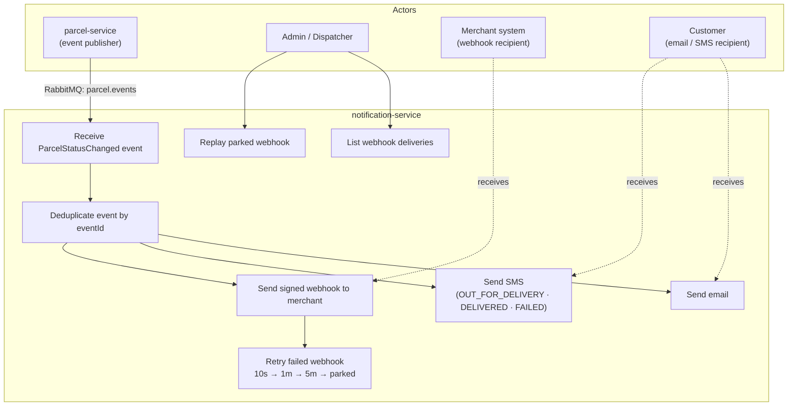
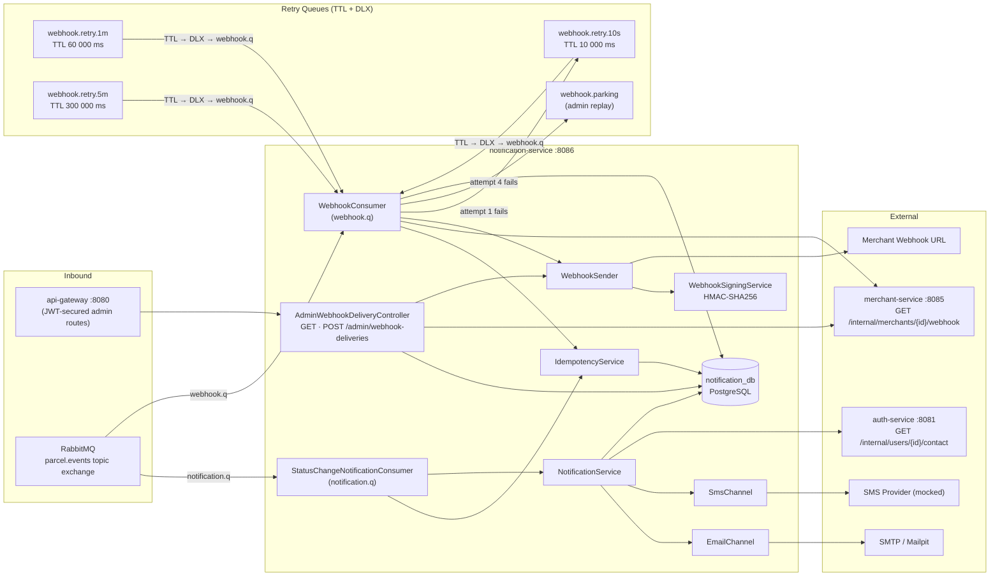
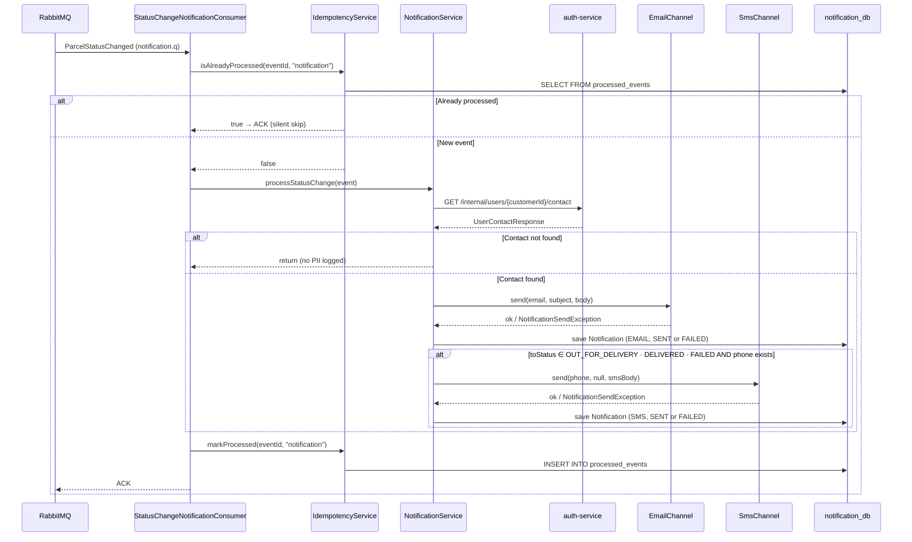
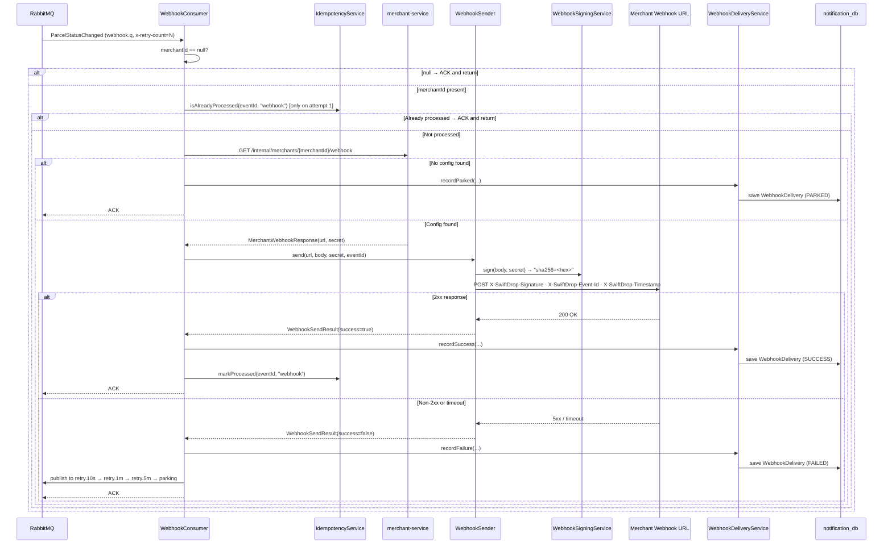
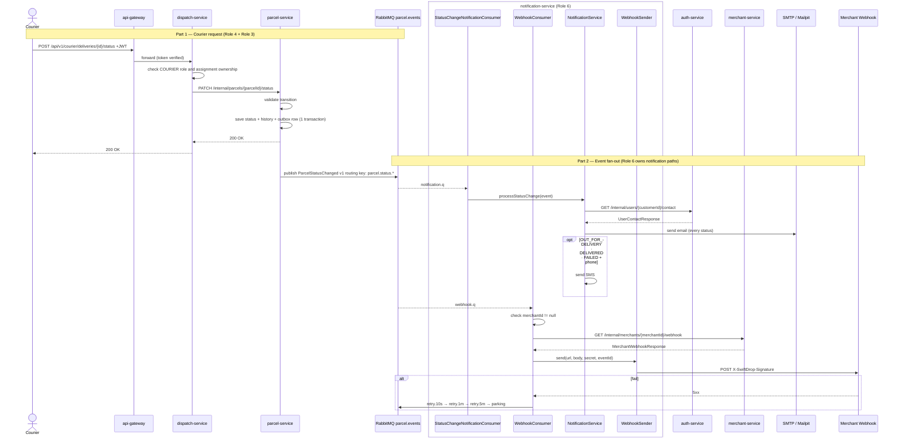
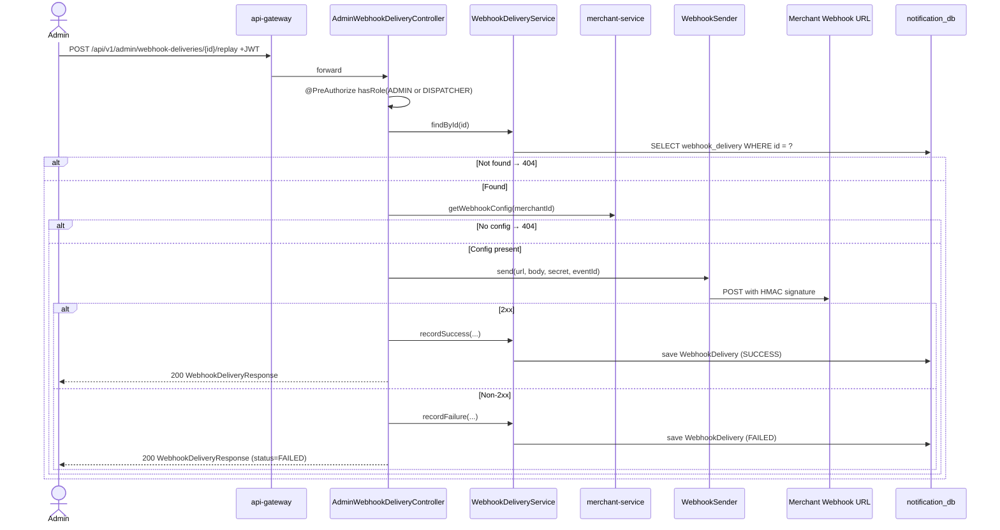
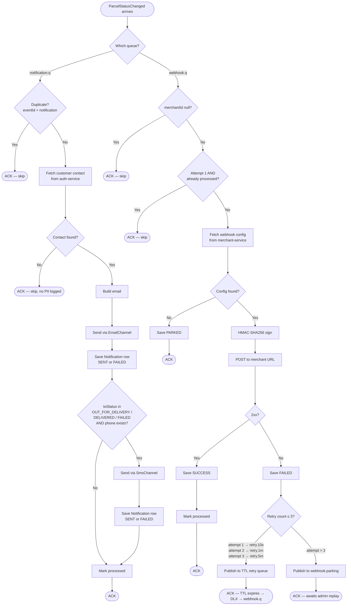
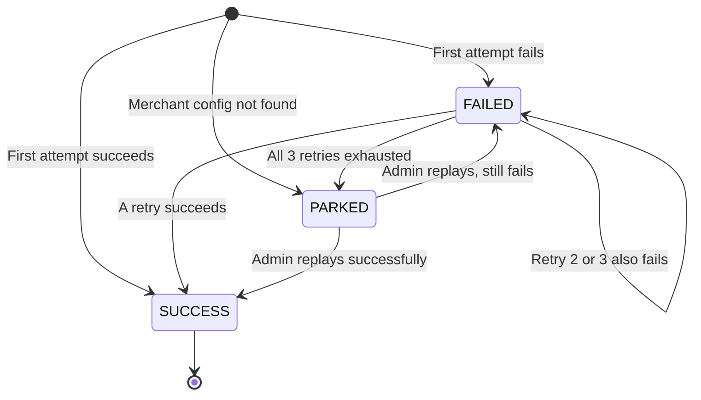
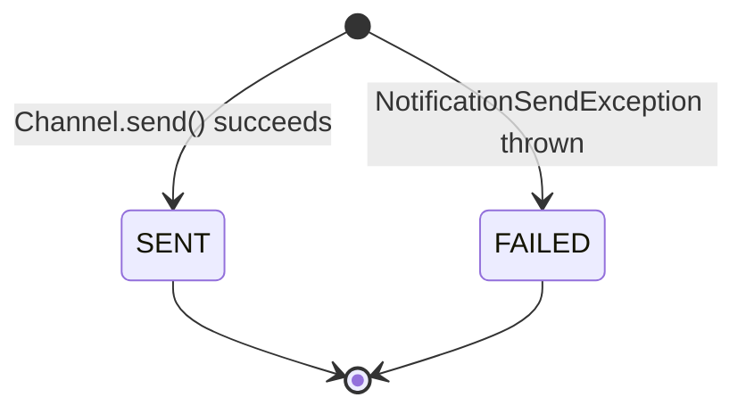

# Notification Service — Design & Architecture

**Module:** `notification-service`  
**Port:** 8086  
**Owner:** Role 6  
**Database:** `notification_db` (PostgreSQL)  
**Base package:** `lk.swiftdrop.notification`  
**Last updated:** October 2026

---

## Contents

1. [Responsibility](#1-responsibility)
2. [Use Cases](#2-use-cases)
3. [Architecture](#3-architecture)
4. [Database Schema](#4-database-schema)
5. [API Surface](#5-api-surface)
6. [Message Consumers](#6-message-consumers)
7. [Webhook Retry Mechanism](#7-webhook-retry-mechanism)
8. [Class Structure](#8-class-structure)
9. [Key Flows — Sequence Diagrams](#9-key-flows--sequence-diagrams)
10. [Activity Flow](#10-activity-flow)
11. [State Machines](#11-state-machines)
12. [Security](#12-security)
13. [Design Decisions and Justifications](#13-design-decisions-and-justifications)
14. [Dependencies on Other Services](#14-dependencies-on-other-services)
15. [Testing Strategy](#15-testing-strategy)
16. [Configuration Reference](#16-configuration-reference)

---

## 1. Responsibility

The notification-service is a **pure event consumer**. It has no awareness of the parcel business rules — it reacts to things that have already happened.

| Responsibility | Detail |
|---|---|
| Email notification | Sent to the customer on **every** parcel status change |
| SMS notification | Sent only for `OUT_FOR_DELIVERY`, `DELIVERED`, and `FAILED` |
| Merchant webhook | HMAC-signed `POST` to the merchant's registered URL when `merchantId` is set |
| Webhook retry | Exponential back-off: 10 s → 1 min → 5 min → parking queue |
| Admin webhook management | REST endpoint to list and replay parked deliveries |
| Idempotency | Deduplicates events by `eventId` per consumer — safe against broker redelivery |

What it does **not** do:

- It does **not** change parcel status. Only `parcel-service` owns that.
- It does **not** store customer addresses, phone numbers, or names — it fetches them live from `auth-service` and never persists them.
- It does **not** have a customer-facing REST API. Its only REST endpoints are admin-only.

---

## 2. Use Cases

Source: `docs/diagrams/usecase-notification.mmd`



---

## 3. Architecture

Source: `docs/diagrams/arch-notification.mmd`



### Why this shape

- **Pure consumer** — no outbound events, no database writes that other services depend on.
- **Two separate queues** (`notification.q`, `webhook.q`) so email/SMS and webhook concerns fail and scale independently.
- **TTL + dead-letter exchange** for retry timing — no polling jobs, no scheduler thread, RabbitMQ handles the wait.
- **RestClient** (Spring 6 / Boot 4.x) with fixed connect (2 s) and read (5 s) timeouts for all outbound HTTP.

---

## 4. Database Schema

All migrations live in `services/notification-service/src/main/resources/db/migration/`.

### `processed_events` (V1)

Stores the record of every successfully processed event per consumer. Prevents duplicate notifications on broker redelivery.

| Column | Type | Notes |
|---|---|---|
| `id` | `uuid` PK | auto-generated |
| `event_id` | `uuid` NOT NULL | the `eventId` from `ParcelStatusChanged` |
| `consumer_name` | `varchar(50)` NOT NULL | `"notification"` or `"webhook"` |
| `processed_at` | `timestamptz` NOT NULL | set at insert |

Unique constraint: `(event_id, consumer_name)`.

### `notifications` (V2)

One row per email or SMS sent (or attempted).

| Column | Type | Notes |
|---|---|---|
| `id` | `uuid` PK | |
| `event_id` | `uuid` NOT NULL | source event |
| `parcel_id` | `uuid` NOT NULL | |
| `tracking_no` | `varchar(20)` NOT NULL | for reference only — no names/addresses |
| `customer_id` | `uuid` NOT NULL | |
| `type` | `varchar(10)` NOT NULL | `EMAIL` or `SMS` |
| `recipient` | `varchar(255)` NOT NULL | masked in logs |
| `subject` | `varchar(500)` | null for SMS |
| `body` | `text` NOT NULL | |
| `status` | `varchar(10)` NOT NULL | `SENT` or `FAILED` |
| `failure_reason` | `text` | null if sent |
| `created_at` | `timestamptz` NOT NULL | |
| `updated_at` | `timestamptz` | set by `@PreUpdate` |

### `webhook_deliveries` (V3)

One row per webhook attempt (initial or retry or replay).

| Column | Type | Notes |
|---|---|---|
| `id` | `uuid` PK | |
| `event_id` | `uuid` NOT NULL | |
| `parcel_id` | `uuid` NOT NULL | |
| `merchant_id` | `uuid` NOT NULL | |
| `webhook_url` | `varchar(2000)` NOT NULL | |
| `http_status` | `int` | null if network error |
| `attempt_number` | `int` NOT NULL | 1, 2, 3 … |
| `status` | `varchar(10)` NOT NULL | `SUCCESS`, `FAILED`, or `PARKED` |
| `request_body` | `text` | full JSON body sent |
| `response_body` | `text` | merchant's response |
| `failure_reason` | `text` | null on success |
| `created_at` | `timestamptz` NOT NULL | |
| `updated_at` | `timestamptz` | set by `@PreUpdate` |

---

## 5. API Surface

The service exposes **no customer-facing endpoints**. The only REST API is admin-only.

Base path: `/api/v1/admin/webhook-deliveries`  
Auth required: JWT with role `ADMIN` or `DISPATCHER`

| Method | Path | Description |
|---|---|---|
| `GET` | `/api/v1/admin/webhook-deliveries` | List all webhook delivery attempts. Optional `?status=FAILED\|PARKED\|SUCCESS` filter. Paginated (`?page=0&size=20`). |
| `POST` | `/api/v1/admin/webhook-deliveries/{id}/replay` | Immediately re-attempts delivery for one record. Returns the new `WebhookDelivery` row. |

### Response body — `WebhookDeliveryResponse`

```json
{
  "id": "3f1a…",
  "eventId": "8f2c…",
  "parcelId": "c41d…",
  "merchantId": "5b17…",
  "webhookUrl": "https://store.example.com/hooks/swiftdrop",
  "httpStatus": 500,
  "attemptNumber": 3,
  "status": "PARKED",
  "failureReason": "Connection timed out",
  "createdAt": "2026-10-21T09:17:00Z"
}
```

OpenAPI spec: `GET http://localhost:8086/v3/api-docs`

---

## 6. Message Consumers

### `StatusChangeNotificationConsumer` — listens on `notification.q`

1. Deserialise `ParcelStatusChanged` from the message body (Jackson2JsonMessageConverter).
2. Check `processed_events` — skip if `(eventId, "notification")` already exists.
3. Call `auth-service` `GET /internal/users/{customerId}/contact` for email + phone + firstName.
4. Build and send email via `EmailChannel` → `JavaMailSender`. Save `Notification` row (`SENT` or `FAILED`).
5. If `toStatus ∈ {OUT_FOR_DELIVERY, DELIVERED, FAILED}` **and** `phone != null`: send SMS via `SmsChannel`. Save `Notification` row.
6. Write `processed_events` row. ACK.

### `WebhookConsumer` — listens on `webhook.q`

1. Read `x-retry-count` header (0 if absent).
2. If `merchantId == null` → ACK and return.
3. If `retryCount == 0` and already processed → ACK and return.
4. Call `merchant-service` `GET /internal/merchants/{merchantId}/webhook`.  
   - If not found → `recordParked(...)` and ACK.
5. HMAC-sign the raw message body (`WebhookSigningService`).
6. `POST` to webhook URL with headers `X-SwiftDrop-Signature`, `X-SwiftDrop-Event-Id`, `X-SwiftDrop-Timestamp`.
7. On 2xx → `recordSuccess(...)`, write `processed_events`, ACK.
8. On non-2xx or exception → `recordFailure(...)`, route to retry queue (see §7).

---

## 7. Webhook Retry Mechanism

Source: `docs/diagrams/seq-webhook-retry.mmd`

```
attempt 1 → fail → webhook.retry.10s (TTL 10 s) → DLX → webhook.q
attempt 2 → fail → webhook.retry.1m  (TTL 60 s) → DLX → webhook.q
attempt 3 → fail → webhook.retry.5m  (TTL 300 s) → DLX → webhook.q
attempt 4 → fail → webhook.parking   (stays until admin replays)
```

- Each retry queue has a **dead-letter exchange (DLX)** configured. When the TTL expires, RabbitMQ automatically routes the message back to `webhook.q` with the incremented `x-retry-count` header.
- The `x-retry-count` header is set to `nextRetryCount` before publishing to the retry queue.
- A `WebhookDelivery` row is written for **every attempt**, so the full history is visible in the admin dashboard.

### HMAC Signing

Every outbound webhook carries:

```
X-SwiftDrop-Signature: sha256=<HexEncodedHMAC-SHA256(body, merchantSecret)>
X-SwiftDrop-Event-Id: <eventId UUID>
X-SwiftDrop-Timestamp: <ISO-8601 UTC instant>
```

The merchant verifies by computing the same HMAC over the raw body with their stored secret and comparing it to the header value. This proves the payload came from SwiftDrop and was not modified in transit.

---

## 8. Class Structure

Source: `docs/diagrams/class-notification.mmd`

```
lk.swiftdrop.notification
│
├── config/
│   ├── RabbitMqConfig            — queues, exchange, DLX, bindings, Jackson converter
│   └── RestClientConfig          — RestClient beans (authClient, merchantClient, webhookClient)
│
├── client/
│   ├── AuthServiceClient         — GET /internal/users/{id}/contact
│   ├── MerchantServiceClient     — GET /internal/merchants/{id}/webhook
│   └── dto/
│       ├── UserContactResponse   — record(email, phone, firstName)
│       └── MerchantWebhookResponse — record(webhookUrl, secret)
│
├── consumer/
│   ├── StatusChangeNotificationConsumer  — @RabbitListener(notification.q)
│   ├── WebhookConsumer                   — @RabbitListener(webhook.q)
│   ├── entity/ProcessedEvent
│   ├── repository/ProcessedEventRepository
│   └── service/IdempotencyService
│
├── notification/
│   ├── channel/
│   │   ├── NotificationChannel   — interface: send(to, subject, body)
│   │   ├── EmailChannel          — JavaMailSender implementation
│   │   ├── SmsChannel            — mock implementation (logs only)
│   │   └── NotificationSendException
│   ├── entity/
│   │   ├── Notification
│   │   ├── NotificationType      — EMAIL, SMS
│   │   └── NotificationStatus    — SENT, FAILED
│   ├── repository/NotificationRepository
│   └── service/NotificationService
│
└── webhook/
    ├── controller/AdminWebhookDeliveryController
    ├── dto/WebhookDeliveryResponse
    ├── entity/
    │   ├── WebhookDelivery
    │   └── WebhookDeliveryStatus  — SUCCESS, FAILED, PARKED
    ├── mapper/WebhookDeliveryMapper
    ├── repository/WebhookDeliveryRepository
    └── service/
        ├── WebhookDeliveryService
        ├── WebhookSender
        └── WebhookSigningService  — HMAC-SHA256
```

---

## 9. Key Flows — Sequence Diagrams

### 9.1 Email / SMS notification flow

Source: `docs/diagrams/seq-notification-email-sms.mmd`



### 9.2 Webhook delivery with retry

Source: `docs/diagrams/seq-webhook-retry.mmd`



### 9.3 Courier status update triggers notification (cross-service, Role 4 + Role 6)

Source: `docs/diagrams/seq-courier-status.mmd` (owned jointly with Role 4)



### 9.4 Admin replays a parked webhook

Source: `docs/diagrams/seq-webhook-replay.mmd`



---

## 10. Activity Flow

Full processing pipeline from event arrival to outcome.

Source: `docs/diagrams/activity-notification.mmd`



---

## 11. State Machines

### WebhookDelivery lifecycle



### Notification lifecycle



> Notifications are immutable after creation. A `FAILED` notification is a permanent audit record. The idempotency row is still written so the event is not reprocessed; failed notifications are not retried automatically.

---

## 12. Security

| Concern | Decision |
|---|---|
| JWT verification | Handled by `common` `SwiftDropSecurityAutoConfiguration`. No custom `SecurityConfig` in this service. Public key fetched from `auth-service` JWKS. |
| Admin endpoints | `@PreAuthorize("hasAnyRole('ADMIN', 'DISPATCHER')")` on the controller. |
| Internal endpoints | No `/internal/**` routes. This service only calls others' internal endpoints — it does not expose any. |
| PII in logs | Tracking numbers and UUIDs are logged. Email addresses, phone numbers, and names are never logged. SLF4J + Logback masking inherited from `common`. |
| Webhook authentication | Outbound: HMAC-SHA256 signature header (`X-SwiftDrop-Signature: sha256=<hex>`). The merchant verifies the signature using their stored secret. |
| Secrets | Merchant webhook secrets, mail credentials, and DB password come from environment variables — never hard-coded. |

---

## 13. Design Decisions and Justifications

| Decision | Justification |
|---|---|
| **Event-driven via RabbitMQ** | Decouples notification delivery from parcel status changes. A slow SMTP server does not delay the courier's response. Reliable with the transactional outbox on the publisher side. |
| **Two separate queues** (`notification.q`, `webhook.q`) | Independent failure domains. A merchant webhook failure does not delay email delivery. Each queue has its own idempotency namespace. |
| **Idempotency table per consumer** | RabbitMQ guarantees at-least-once delivery. The `processed_events` table, checked before processing and written after success, prevents duplicate emails and SMS even across service restarts. |
| **SMS only for three statuses** | Cost control and UX. Customers care most about "courier is coming", "delivered", and "failed". Lower-priority transitions (e.g., IN_TRANSIT) are covered by email. |
| **Webhook only when `merchantId != null`** | B2C parcels have no merchant. Sending webhooks for customer-booked parcels would be wrong and wasteful. |
| **HMAC-SHA256 signing** | Industry-standard (same as Stripe and GitHub). Merchants can verify payload authenticity without a shared session. The signature covers the full body, so partial tampering is detectable. |
| **TTL + DLX retry** | No scheduled jobs, no `Thread.sleep`, no polling. RabbitMQ handles timing. The dead-letter exchange re-queues the message with the original body and an incremented header. |
| **Admin replay endpoint** | Ops team can recover permanently parked webhooks without touching the database directly or restarting the service. Every replay is recorded as a new `WebhookDelivery` row. |
| **No `SecurityConfig.java`** | `common` auto-configures Spring Security OAuth2 Resource Server uniformly across all services. Adding a local `SecurityConfig` would create a divergence risk and duplicate security logic. |
| **Constructor injection only** | Makes every dependency explicit and test-friendly. No `@Autowired` field injection, no hidden state. Spring manages the lifecycle. |
| **`NotificationChannel` interface** | Follows the Adapter pattern. `EmailChannel` and `SmsChannel` implement the same interface, making it trivial to add a push-notification channel later without changing `NotificationService`. |

---

## 14. Dependencies on Other Services

| What is needed | From | Endpoint | Called by |
|---|---|---|---|
| Customer email, phone, first name | `auth-service` | `GET /internal/users/{customerId}/contact` | `NotificationService` |
| Merchant webhook URL and secret | `merchant-service` | `GET /internal/merchants/{merchantId}/webhook` | `WebhookConsumer`, `AdminWebhookDeliveryController` |
| `ParcelStatusChanged` event DTO | `common` module | N/A — library jar | Consumers |
| `ParcelEvents` exchange/routing constants | `common` module | N/A — library jar | `RabbitMqConfig` |

**We do not call `parcel-service` at runtime.** All data about the parcel that we need (tracking number, parcel ID, customer ID, merchant ID) arrives inside the event payload.

---

## 15. Testing Strategy

| Level | Class suffix | What is tested | Tools |
|---|---|---|---|
| Unit | `Test.java` | Service logic, channel send, HMAC signing, idempotency | JUnit 5, Mockito |
| Controller | `Test.java` | HTTP status codes, role-based access (ADMIN, DISPATCHER, CUSTOMER, COURIER, unauthenticated) | MockMvc, `@WebMvcTest`, `@MockitoBean` |
| Integration | `IT.java` | Full event → database flow, duplicate skip, webhook retry → parking | Testcontainers (PostgreSQL + RabbitMQ), Awaitility |

Coverage target: **≥ 70% line coverage** (CI enforced via JaCoCo).

Key test names (behaviour-driven):
- `statusChangeEventTriggersNotificationProcessing`
- `duplicateEventIsSkipped`
- `eventWithMerchantIdButNoWebhookConfigGetsParked`
- `customerCannotAccessAdminEndpoint`
- `adminCanReplayDelivery`
- `replayReturns404ForNonexistentDelivery`

---

## 16. Configuration Reference

All values come from environment variables. Defaults suitable for local development are shown.

| Property | Env var | Default | Notes |
|---|---|---|---|
| `spring.datasource.url` | `NOTIFICATION_DB_URL` | `jdbc:postgresql://localhost:5432/notification_db` | |
| `spring.datasource.username` | `NOTIFICATION_DB_USERNAME` | `swiftdrop` | |
| `spring.datasource.password` | `NOTIFICATION_DB_PASSWORD` | *(no default — required)* | Secret |
| `spring.mail.host` | `MAIL_HOST` | `localhost` | Mailpit locally |
| `spring.mail.port` | `MAIL_PORT` | `1025` | |
| `swiftdrop.notification.from-email` | `NOTIFICATION_FROM_EMAIL` | `noreply@swiftdrop.lk` | |
| `swiftdrop.notification.tracking-base-url` | `TRACKING_BASE_URL` | `http://localhost:3000/track` | Used in email/SMS body |
| `swiftdrop.services.auth-url` | `AUTH_SERVICE_URL` | `http://localhost:8081` | |
| `swiftdrop.services.merchant-url` | `MERCHANT_SERVICE_URL` | `http://localhost:8085` | |
| `spring.security.oauth2.resourceserver.jwt.jwk-set-uri` | `JWT_JWK_SET_URI` | `http://localhost:8081/.well-known/jwks.json` | |
| `rabbitmq.queues.notification` | — | `notification.q` | |
| `rabbitmq.queues.webhook` | — | `webhook.q` | |
| `rabbitmq.queues.webhook-retry-10s` | — | `webhook.retry.10s` | TTL 10 000 ms |
| `rabbitmq.queues.webhook-retry-1m` | — | `webhook.retry.1m` | TTL 60 000 ms |
| `rabbitmq.queues.webhook-retry-5m` | — | `webhook.retry.5m` | TTL 300 000 ms |
| `rabbitmq.queues.webhook-parking` | — | `webhook.parking` | |
| `rabbitmq.dlx.webhook` | — | `webhook.dlx` | Dead-letter exchange |

