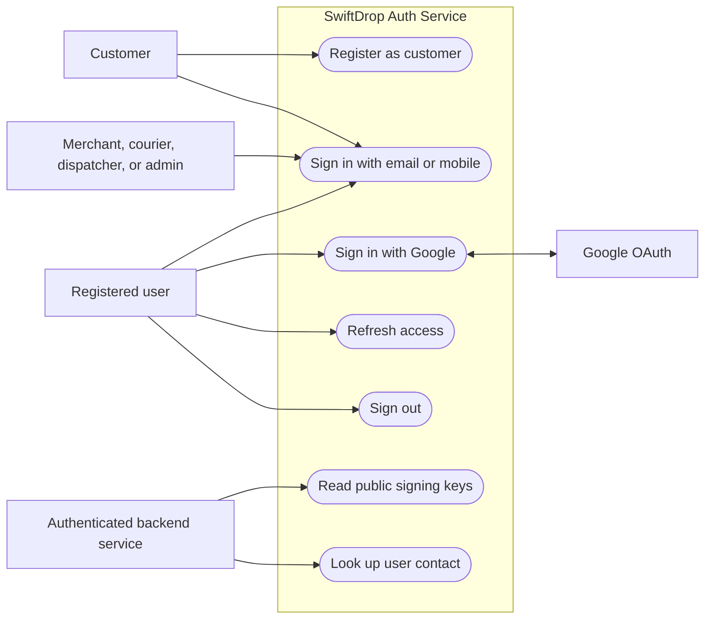
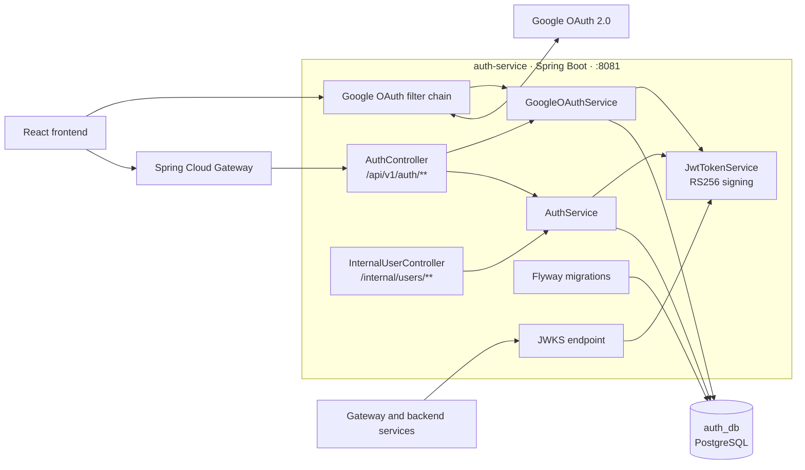
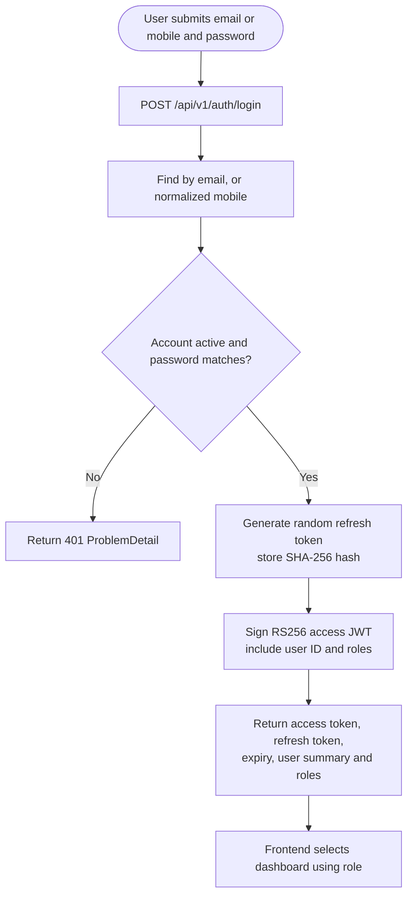
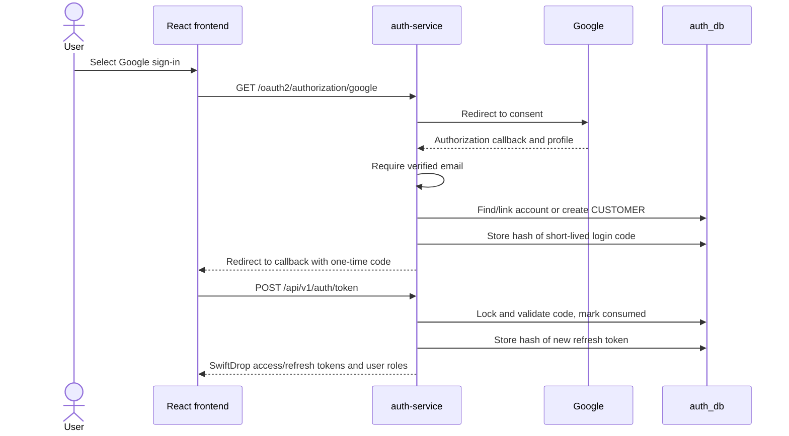
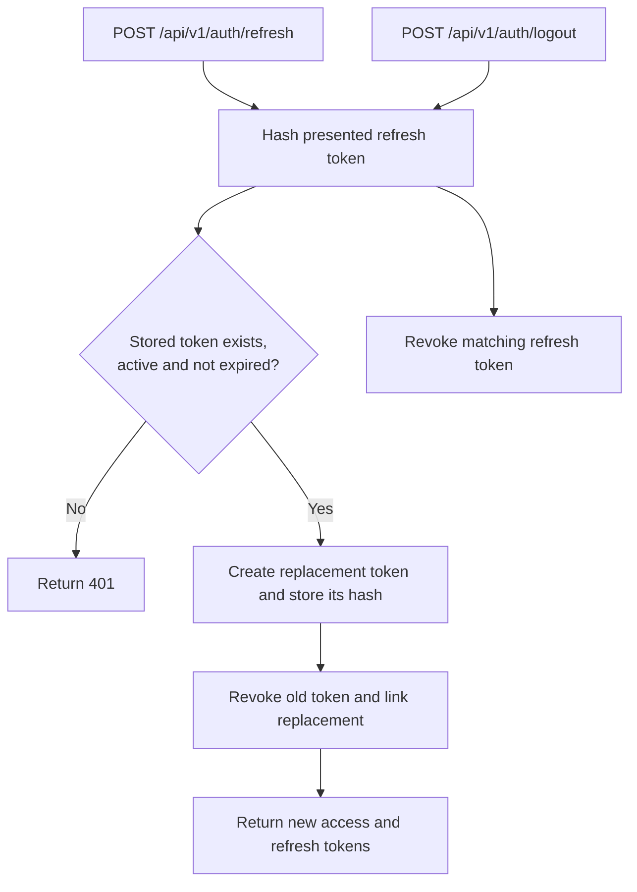
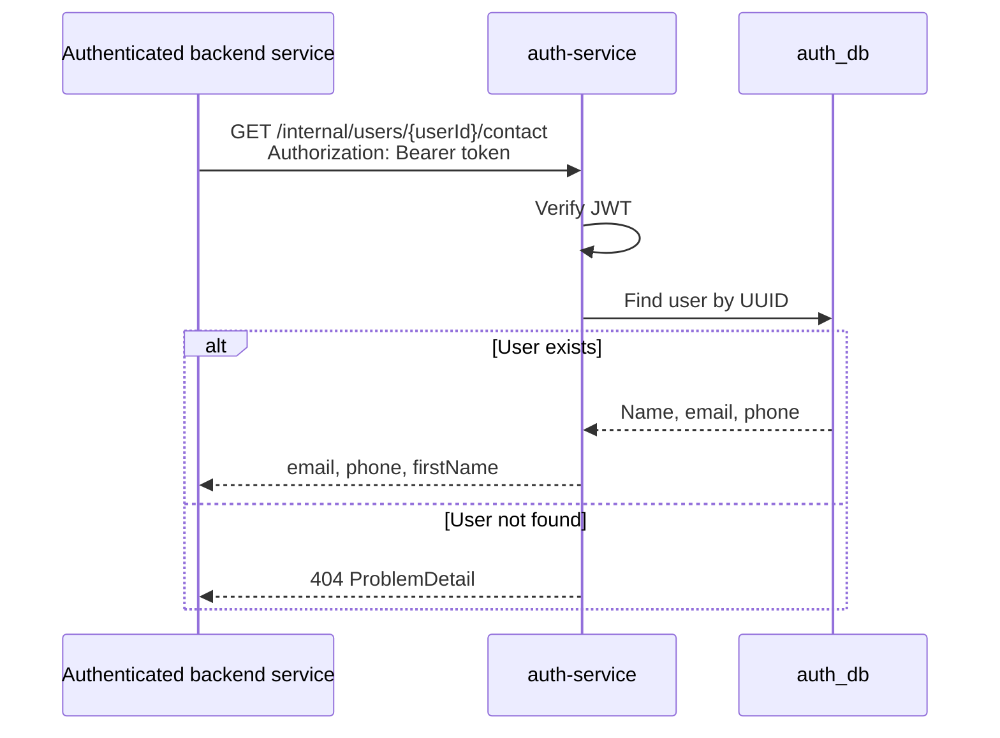

# SwiftDrop Auth Service

The auth-service is the system of record for user identities and roles. It handles
registration, credential verification, Google OAuth login, token issuance and
revocation, publishes its public signing key, and provides a protected user-contact
lookup for backend callers.

The service is a Spring Boot application on port `8081`. The platform architecture
and shared conventions are documented in [`../../docs/architecture.md`](../../docs/architecture.md)
and [`../../docs/conventions.md`](../../docs/conventions.md). Local key setup and
OAuth configuration are also covered in [`../../docs/auth-service.md`](../../docs/auth-service.md).

## Use cases



New password and Google signups receive the `CUSTOMER` role. Merchant, courier,
dispatcher, and admin accounts must already have the corresponding role assigned;
role provisioning and administrative user management are outside the current
auth-service API.

## Architecture



The gateway routes public `/api/v1/auth/**` traffic to auth-service. The internal
contact endpoint is not routed by the gateway and requires a valid bearer token.
The JWKS endpoint is used by the gateway and services to verify access tokens;
they verify tokens locally instead of asking auth-service to validate every request.

### Main responsibilities

| Component | Responsibility |
|---|---|
| `AuthController` | Signup, password login, refresh, logout, and Google-code exchange API |
| `GoogleOAuthSecurityConfiguration` | Google authorization-code flow and frontend callback |
| `AuthService` | User lookup, password verification, refresh-token lifecycle, and contact lookup |
| `GoogleOAuthService` | Verify Google profile, link/create the local account, and exchange one-time login codes |
| `JwtTokenService` | Create RS256 access tokens and secure random refresh/login codes |
| `InternalUserController` | Expose authenticated `GET /internal/users/{userId}/contact` |
| Flyway | Create and evolve the auth database schema at service startup |

## Authentication and token flows

### Email/mobile and password



### Google OAuth



The authorization-code flow keeps Google credentials on the backend. The browser
receives a short-lived, single-use code rather than Google credentials or a SwiftDrop
signing key.

### Refresh and logout



### Backend contact lookup



This endpoint is intended for backend-to-backend calls. The browser should not call
it, and callers should handle phone numbers and email as personal data.

## API reference

| Method and path | Description |
|---|---|
| `POST /api/v1/auth/signup` | Create an active customer account and return SwiftDrop tokens |
| `POST /api/v1/auth/login` | Verify email/mobile and password; return tokens and user roles |
| `POST /api/v1/auth/refresh` | Rotate a refresh token |
| `POST /api/v1/auth/logout` | Revoke a refresh token; safe to repeat |
| `GET /oauth2/authorization/google` | Start Google OAuth login (when configured) |
| `GET /login/oauth2/code/google` | Google OAuth callback handled by Spring Security |
| `POST /api/v1/auth/token` | Exchange a single-use Google login code for SwiftDrop tokens |
| `GET /internal/users/{userId}/contact` | Return contact details to an authenticated backend caller |
| `GET /.well-known/jwks.json` | Publish public signing keys for access-token verification |

Signup passwords must contain 12–72 characters. Login accepts a password up to 72
characters. Request DTOs are validated with Bean Validation.

### Token response shape

```json
{
  "accessToken": "<signed-access-token>",
  "tokenType": "Bearer",
  "accessTokenExpiresAt": "2026-10-31T12:15:00Z",
  "refreshToken": "<opaque-refresh-token>",
  "user": {
    "id": "00000000-0000-0000-0000-000000000000",
    "fullName": "Demo Customer",
    "email": "customer@example.test",
    "roles": ["CUSTOMER"]
  }
}
```

Access tokens are RS256 JWTs with a 15-minute lifetime. Refresh tokens have a
seven-day lifetime; only their SHA-256 hashes are stored. Do not log, commit, or
share real tokens or personal data.

### Contact response shape

`GET /internal/users/{userId}/contact` returns:

```json
{
  "email": "customer@example.test",
  "phone": "+94771234567",
  "firstName": "Demo"
}
```

The contact route is protected by shared bearer-token security. “Internal” means it
is not exposed through the API gateway; network-level isolation should also be
maintained in deployment.

## Database

Flyway migrations are in `src/main/resources/db/migration`. They run when the
service starts. Hibernate is configured with `ddl-auto: validate`, so Hibernate
checks the schema but does not create or alter tables.

| Migration | Schema change |
|---|---|
| `V1__create_auth_tables.sql` | Users, roles and assignments, refresh tokens, OAuth accounts, merchant profiles, courier profiles; seeds supported roles |
| `V2__create_oauth_login_codes.sql` | One-time Google login-code storage |
| `V3__unique_user_mobile_numbers.sql` | Unique index on non-empty mobile numbers |

Use a new migration for schema changes. Do not modify a migration that has already
been shared or applied.

## Design justifications

| Decision | Justification |
|---|---|
| Separate auth-service and `auth_db` | Keeps identity data owned by one service and avoids cross-service database access. |
| RS256 JWTs and JWKS | Services can verify tokens with a public key without sharing the private signing key or calling auth-service for every request. |
| Short-lived access token and rotating refresh token | Limits the exposure window for access tokens and reduces the usefulness of a stolen refresh token after rotation/revocation. |
| Store only refresh-token and OAuth-code hashes | A database read does not reveal reusable raw bearer credentials. |
| Google OAuth handled server-side | Keeps the OAuth client secret off the browser and allows verified Google identity to be linked to SwiftDrop roles. |
| Single-use, short-lived Google login code | Avoids placing a long-lived application token in the OAuth redirect URL. |
| Role claim in the access token | Lets downstream services enforce role authorization locally; the frontend role redirect is for navigation, not a security boundary. |
| Flyway migrations with Hibernate validation | Provides repeatable, versioned schema creation while preventing implicit schema changes at runtime. |
| Protected, non-gateway contact endpoint | Lets backend services retrieve contact data when needed without making the endpoint part of the public browser API. |

## Running locally

The service needs PostgreSQL, a valid `JWT_PRIVATE_KEY_B64`, and the corresponding
database environment variables. From the repository root, run:

```bash
bash ./mvnw -pl services/auth-service -am spring-boot:run
```

For Docker Compose, start PostgreSQL and auth-service:

```bash
sudo docker compose -f deploy/compose/docker-compose.yml up --build -d postgres auth-service
sudo docker compose -f deploy/compose/docker-compose.yml logs --tail=100 auth-service
```

The Compose setup reads `deploy/compose/.env` when present. Do not add real keys or
passwords to this README. Once started, check the JWKS endpoint at
`http://localhost:8081/.well-known/jwks.json`. In Compose, PostgreSQL is exposed on
host port `5433`; the service connects to `auth_db` over the Compose network.

Google login is optional. Configure the OAuth client ID, secret, callback URI, and
frontend feature flag before enabling it. Follow the setup steps in
[`../../docs/auth-service.md`](../../docs/auth-service.md).

## Testing

From the repository root:

```bash
JAVA_HOME=/usr/lib/jvm/java-21-openjdk-amd64 \
PATH=/usr/lib/jvm/java-21-openjdk-amd64/bin:$PATH \
bash ./mvnw -pl services/auth-service -am test
```

The auth-service tests cover credential flows, refresh-token behavior, Google login
code handling, endpoint behavior, and contact lookup authorization.
